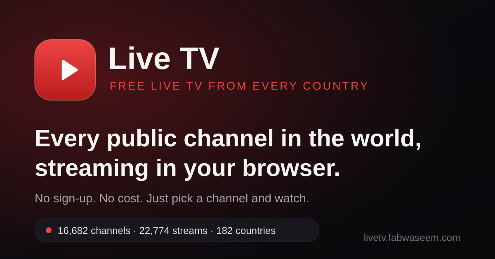

# Live TV

**Every public channel in the world, streaming in your browser — free, with no sign-up.**

### ▶ Watch now: [livetv.fabwaseem.com](https://livetv.fabwaseem.com)

Live TV is a worldwide live-television catalogue and player. It aggregates publicly available live streams from open, community-maintained sources into one fast, searchable app: **16,682 channels · 22,774 streams · 182 countries** (and counting).



## Features

- **Huge worldwide catalogue** — over 16,000 channels from 182 countries: news, sports, movies, music, kids, documentary, entertainment and more.
- **Search & filter** — instant search across every channel, plus category filters and a searchable country picker with flag and channel counts.
- **Favorites** — star the channels you love and keep them one tap away (stored locally in your browser, no account needed).
- **Custom player** — a full-window player built for TV: play/pause, volume, fullscreen, a seekable progress bar for DVR-style streams, and a stream switcher when a channel offers more than one source.
- **Automatic fallback** — if a stream fails, the player quietly tries the channel's alternate streams, and many streams are routed through a built-in proxy that fixes hotlink/CORS restrictions — so far more channels just play.
- **Mobile-first shell** — on phones the filters live in a slide-in drawer behind a slim top bar; generous touch targets and safe-area aware chrome throughout.
- **No sign-up, no cost** — open the page, pick a channel, watch.

## How it works

The catalogue is assembled **server-side** in [`lib/iptv.ts`](lib/iptv.ts) from open data sources, joined, cleaned and deduplicated by stream URL:

| Source | What it contributes |
| --- | --- |
| [iptv-org](https://github.com/iptv-org/database) database API | The backbone: streams, channels, logos, categories and countries |
| [Free-TV/IPTV](https://github.com/Free-TV/IPTV) | Community playlist merged on top of the backbone |
| [BuddyChewChew/app-m3u-generator](https://github.com/BuddyChewChew/app-m3u-generator) | Daily-regenerated FAST platform lists — Samsung TV Plus, Pluto TV, The Roku Channel, Tubi |
| [Alplox/json-teles](https://github.com/Alplox/json-teles) | Curated per-country lists, mostly Latin American / Spanish and other local channels |

The joined payload is built once and memoized for an hour (the upstream files are several MB each), then served to the client from `/api/channels`. Entries carrying token parameters are dropped, and where sources overlap, the backbone's metadata wins.

Playback goes through [`/api/stream`](app/api/stream/route.ts), a guarded proxy that only serves URLs present in the catalogue (it is not an open proxy). It rewrites HLS playlists so segments and keys route back through the proxy, and applies the per-stream User-Agent/Referer some broadcasters require. In the browser, [hls.js](https://github.com/video-dev/hls.js) handles playback with a fallback chain: direct → proxied → next alternate stream.

## Tech stack

- **Next.js 16** (App Router) · **React 19** · **TypeScript** (strict)
- **Tailwind CSS 4** with a custom design-token theme — no component library, all UI is bespoke
- **hls.js** for HLS playback
- Packaged as a **Docker** image and deployed with **Coolify**

## Local development

Requires Node.js 20+ (the production image runs Node 24) and npm.

```bash
npm install
npm run dev        # http://localhost:3000
```

Other scripts:

```bash
npm run build      # production build
npm run start      # serve the production build
npm run lint       # ESLint
```

There is no database and no environment configuration — the catalogue is fetched from the public sources above at runtime.

## Project structure

```
app/
  page.tsx            single-page catalogue (renders LiveTvApp)
  layout.tsx          metadata, icons, structured data
  api/channels/       the joined catalogue payload (JSON)
  api/stream/         guarded HLS stream proxy
  robots.ts  sitemap.ts  manifest.ts   SEO plumbing
components/
  LiveTvApp.tsx       shell: sidebar/drawer, filters, channel grid
  ChannelTile.tsx     channel card
  CountrySelect.tsx   searchable country dropdown
  PlayerModal.tsx     full-window custom player
lib/
  iptv.ts             catalogue build: fetch, join, dedupe, memoize
public/
  icons/  og.png  icon.svg             brand assets (scripts/gen-icons.mjs)
```

## Deployment

The repo ships a multi-stage `Dockerfile` (deps → build → runner on `node:24-bookworm-slim`). The live site runs on Coolify with auto-deploy on every push to `main`.

## Disclaimer

Live TV does not host, own or rebroadcast any stream. It aggregates **publicly available stream links published by open, community-maintained sources** and plays them in the browser. All channels, logos and content belong to their respective broadcasters and rights holders.

Stream availability is **not guaranteed**: individual streams may go offline, change, or be geo-restricted by their broadcaster at any time, and some may not play in every country or network. If you are a rights holder and want a link removed, please open an issue.
